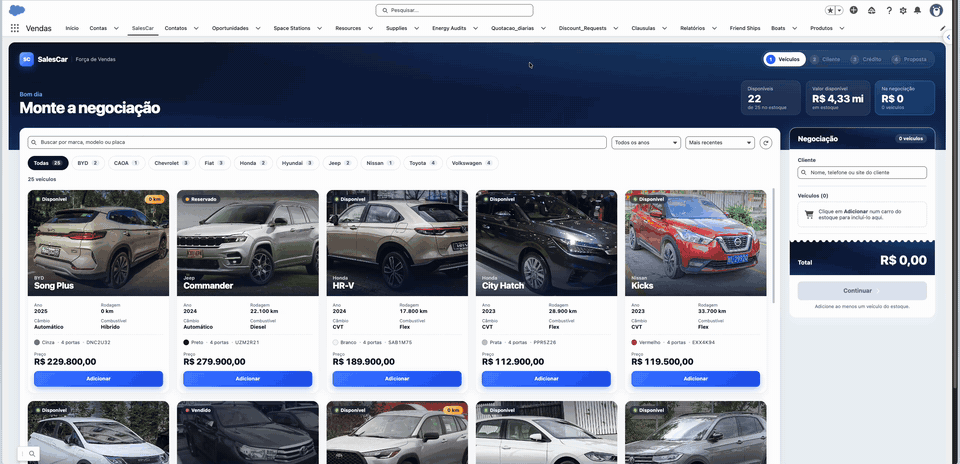
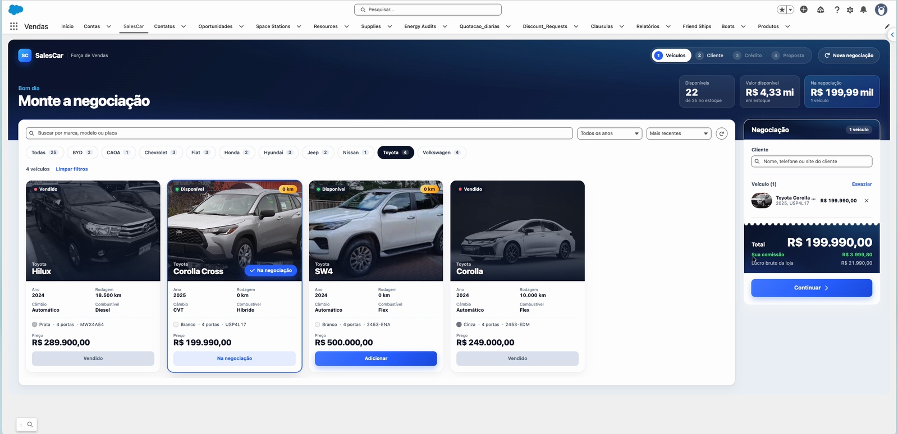
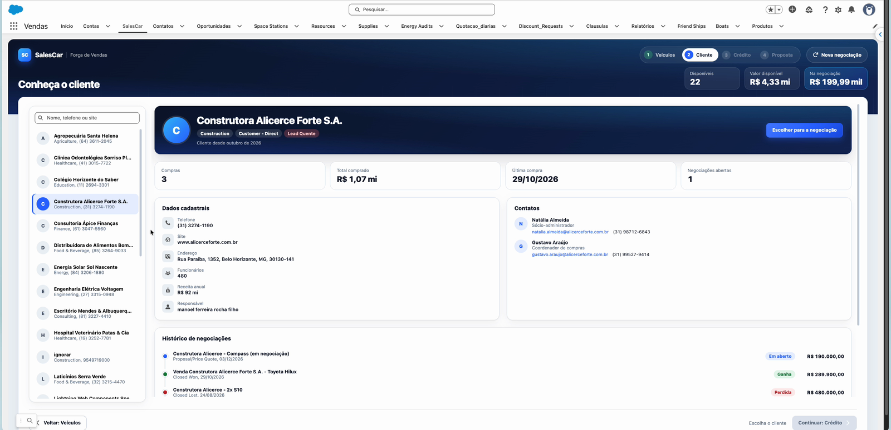
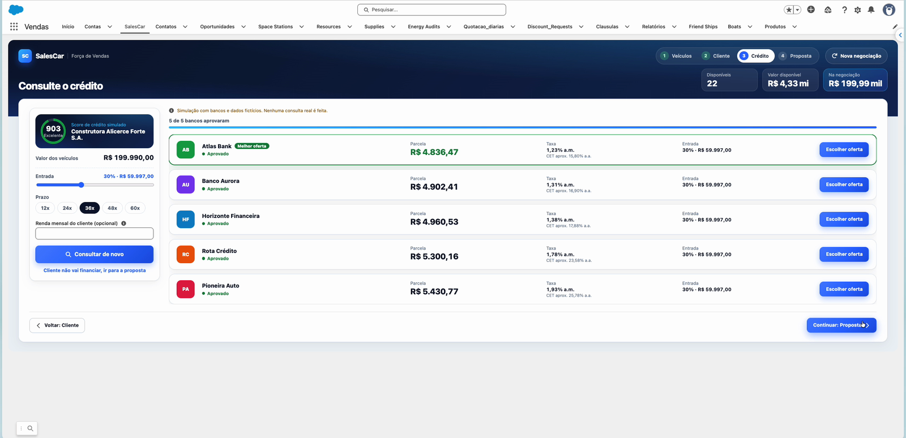
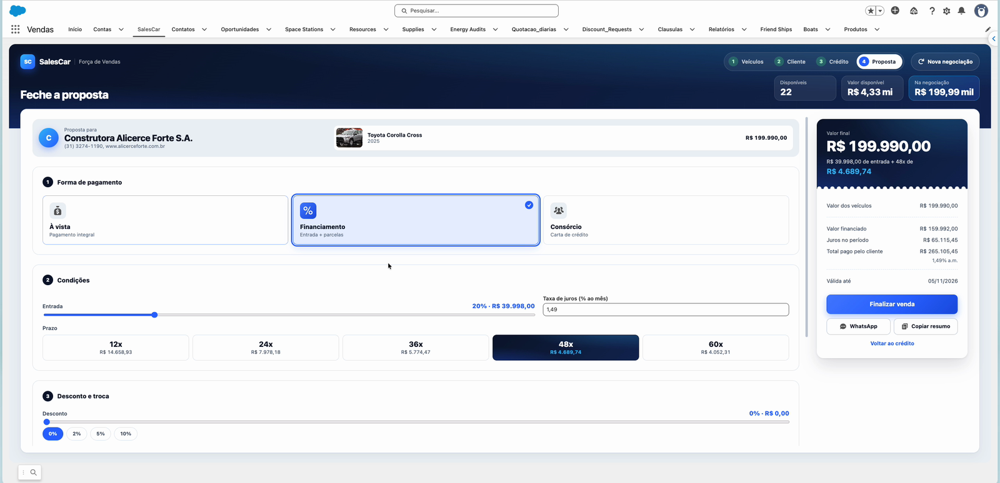
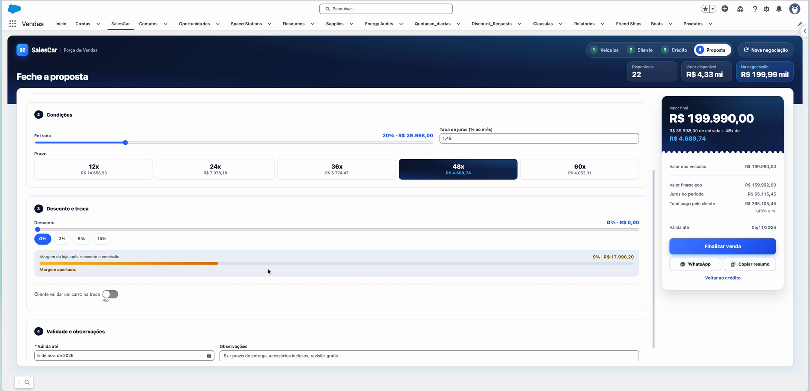
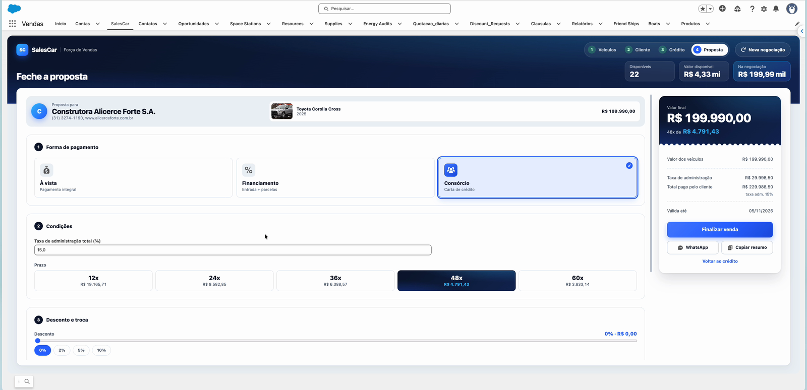
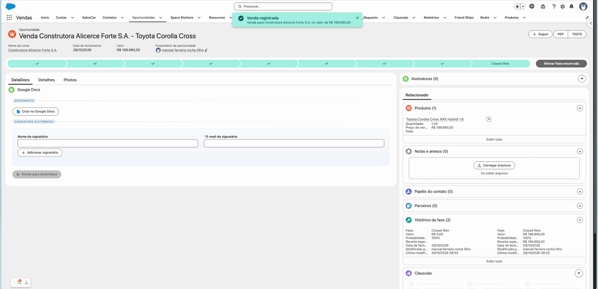
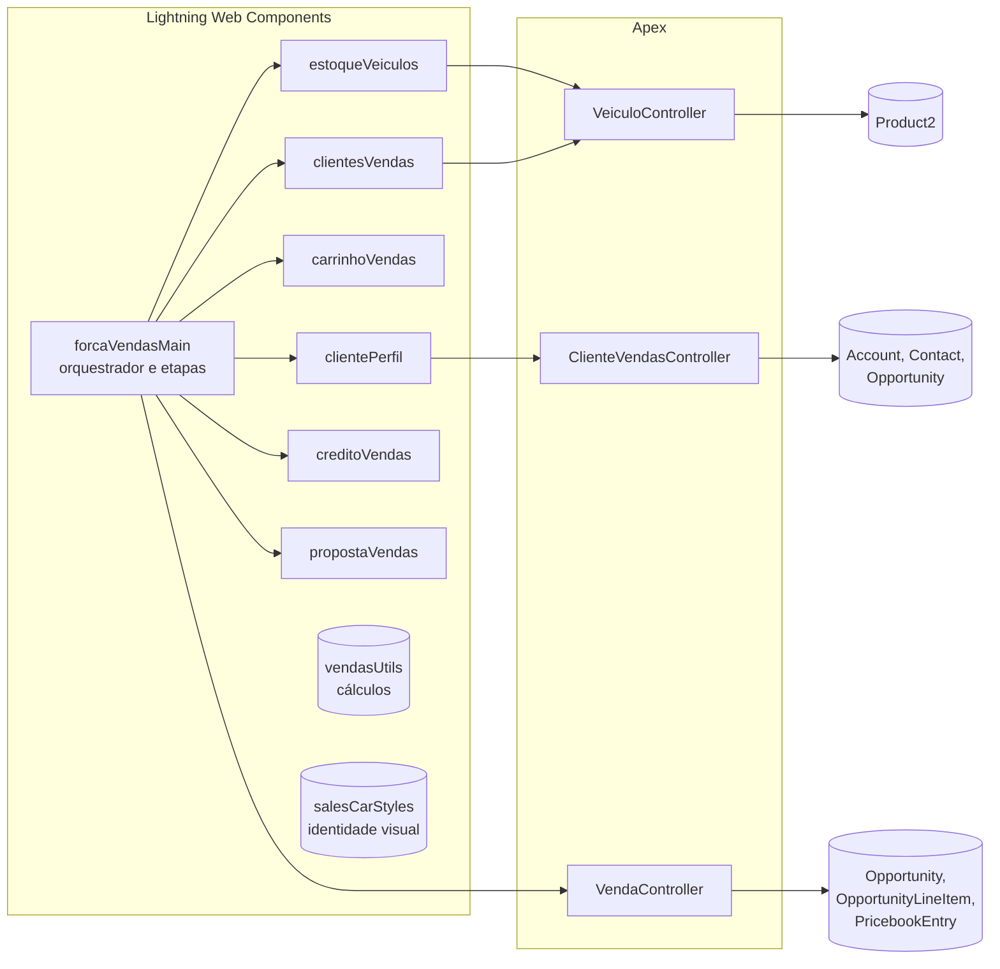

<div align="center">

# SalesCar

**Força de vendas de veículos dentro do Salesforce: da vitrine à venda fechada em 4 etapas.**




🎬 **[Assista ao vídeo completo com legendas (54s, MP4)](docs/salescar-demo.mp4)**

</div>

---

## O que é

O SalesCar é uma aplicação em **Lightning Web Components + Apex** para o vendedor de uma concessionária conduzir a venda inteira numa só tela, dentro do Salesforce:

1. **Veículos**: escolhe os carros numa vitrine com fotos, filtros e indicadores do estoque.
2. **Cliente**: encontra o comprador e vê o perfil completo, com histórico de compras e contatos.
3. **Crédito**: simula o financiamento em 5 bancos de uma vez e escolhe a melhor oferta.
4. **Proposta**: ajusta pagamento, desconto e troca vendo a margem da loja ao vivo, e fecha a venda.

Ao finalizar, a venda vira uma **Opportunity "Closed Won"** com os veículos como produtos, e os carros passam a **Vendido** no estoque.

---

## A jornada

### 1. Veículos: monte a negociação

Vitrine com foto, status (disponível, reservado, vendido), selo **0 km**, amostra de cor e ficha técnica. Filtro por marca em chips, por ano e ordenação. Carro vendido não pode ser adicionado. O painel **Negociação** fica sempre à vista, com total, **comissão do vendedor** e **lucro da loja**.




### 2. Cliente: conheça quem está comprando

Busca de contas e perfil completo: segmento, classificação do lead (quente, morno, frio), compras anteriores, total já comprado, contatos com e-mail e telefone, e a **linha do tempo** das negociações (ganhas, perdidas e abertas).



### 3. Crédito: compare 5 bancos de uma vez

Score do cliente num medidor circular. O vendedor ajusta entrada, prazo e renda, e os bancos respondem em sequência: **aprovado**, **aprovado com condição**, **em análise** ou **recusado**, com o motivo. Cada aprovação traz parcela, taxa ao mês, custo efetivo anual aproximado e entrada, e a **melhor oferta** fica em destaque. Escolher uma oferta leva as condições direto para a proposta.

> A consulta de crédito é uma **simulação** com bancos e dados fictícios. A tela avisa isso; nenhuma consulta real é feita.



### 4. Proposta: feche a venda

- **Forma de pagamento** em cartões: à vista, financiamento (tabela Price) ou consórcio (com taxa de administração).
- **Comparador de prazos**: 12, 24, 36, 48 e 60 parcelas lado a lado.
- **Desconto** com controle deslizante e atalhos, e um **medidor de margem da loja** que fica âmbar ou vermelho quando o desconto aperta a margem.
- **Carro na troca**, abatido do valor final.
- **Ticket de resumo** com o valor final, mais **Copiar resumo** e **Enviar no WhatsApp**, que já monta o texto da proposta.







### Venda registrada

Um clique em **Finalizar venda** cria a Opportunity ganha, inclui os veículos como produtos, grava o resumo da proposta na descrição, marca os carros como vendidos e abre o registro.



---

## Arquitetura



| Peça | Responsabilidade |
|---|---|
| `forcaVendasMain` | Estado da negociação, as 4 etapas, a abertura com indicadores e a finalização da venda |
| `estoqueVeiculos` | Vitrine, busca, filtros por marca e ano, ordenação |
| `clientesVendas` / `carrinhoVendas` | Painel de negociação: cliente, veículos e totais |
| `clientePerfil` | Etapa Cliente: lista de contas e perfil completo |
| `creditoVendas` | Etapa Crédito: score e consulta simulada a 5 bancos |
| `propostaVendas` | Etapa Proposta: pagamento, desconto, troca, margem e compartilhamento |
| `vendasUtils` | Funções puras de cálculo: resumo, financiamento Price, consórcio, formatação |
| `salesCarStyles` | Módulo só de CSS com a identidade visual compartilhada |
| `VeiculoController` | Estoque e busca de clientes |
| `ClienteVendasController` | Perfil do cliente com contatos e histórico |
| `VendaController` | Registra a venda numa transação única |

### Decisões técnicas

- **Segurança:** todas as classes usam `with sharing`. As leituras passam por `Security.stripInaccessible`, então campos sem permissão (como o custo do carro) voltam vazios em vez de quebrar a tela. O medidor de margem só aparece para quem enxerga o custo.
- **Venda atômica:** o `VendaController` usa `Savepoint`: ou grava tudo (Opportunity, produtos, status dos carros), ou nada. Os veículos são lidos com `FOR UPDATE`, o que impede dois vendedores de venderem o mesmo carro ao mesmo tempo.
- **Catálogo de preços automático:** veículo sem preço no catálogo padrão ganha o preço do cadastro na hora da venda.
- **Funciona em org com namespace:** os controllers leem campos com `SObject.get()` e devolvem DTOs com nomes neutros, porque em orgs com namespace os mapas de campos e os SObjects chegam ao LWC com as chaves prefixadas.
- **Cálculos testáveis:** juros, parcelas e margem ficam em funções puras no `vendasUtils`, cobertas por testes Jest.
- **Identidade visual compartilhada:** o tema "showroom à noite" fica em um módulo só de CSS (`@import 'c/salesCarStyles'`), sem biblioteca externa.

---

## Estrutura do repositório

```
force-app/main/default/
├── classes/            # 3 controllers Apex + testes
├── lwc/                # 9 componentes (7 de tela, 1 de cálculos, 1 de estilos)
├── objects/Product2/   # 16 campos do veículo (marca, modelo, preço, custo, status...)
├── permissionsets/     # SalesCar – Vendedor
└── tabs/               # Aba "SalesCar"
scripts/dados/          # 20 clientes, 39 contatos, 48 oportunidades e 20 carros de exemplo
docs/                   # GIF, vídeo, capturas e créditos das fotos
```

---

## Instalação

Pré-requisitos: [Salesforce CLI](https://developer.salesforce.com/tools/salesforcecli) e uma org (Developer Edition, sandbox ou scratch org).

```bash
# 1. Clonar
git clone https://github.com/Manoel-Fr/salescar.git
cd salescar

# 2. Conectar a org
sf org login web --alias salescar

# 3. Publicar os metadados
sf project deploy start --source-dir force-app --target-org salescar

# 4. Dar acesso ao seu usuário
sf org assign permset --name SalesCar_Vendedor --target-org salescar

# 5. (Opcional) Carregar os dados de exemplo
sf data import tree --plan scripts/dados/plano.json --target-org salescar

# 6. Abrir a aba SalesCar
sf org open --target-org salescar --path lightning/n/SalesCar
```

> Se a org tiver namespace, o caminho da aba fica `lightning/n/<namespace>__SalesCar`.

---

## Testes

```bash
# Testes Jest dos componentes e dos cálculos
npm install
npm test

# Testes Apex na org
sf apex run test --class-names VeiculoControllerTest ClienteVendasControllerTest VendaControllerTest \
  --result-format human --code-coverage --target-org salescar
```

---

## Dados de exemplo

Todos os clientes, contatos, placas, chassis e valores são **fictícios**. As fotos dos carros vêm do Wikimedia Commons, sob licenças Creative Commons; veja os [créditos das fotos](docs/CREDITOS-FOTOS.md).

## Licença

[MIT](LICENSE) © Manoel Ferreira
